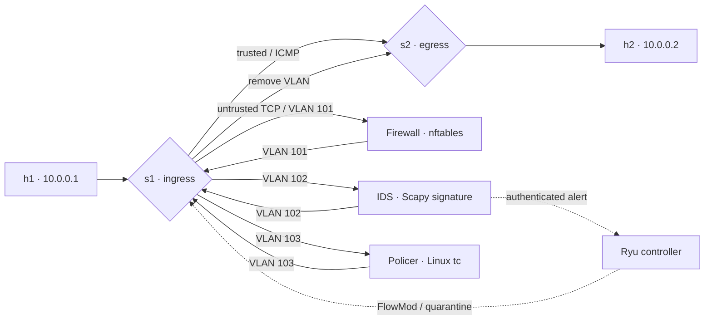

# ChainLab: Automated Service Function Chaining with SDN and NFV

ChainLab is a live, explainable Advanced Computer Networks project. Ryu makes
per-flow decisions; Open vSwitch executes those decisions; three Docker VNFs
provide firewalling, intrusion detection, and traffic shaping. A browser
dashboard shows how packets progress through the chain and how an IDS alert
changes the switch behavior.

## What the audience can watch

1. Ping and trusted TCP/8080 take the short `h1 → s1 → s2 → h2` route.
2. New untrusted TCP flows produce a `PacketIn`. Ryu examines the five-tuple
   and installs four OpenFlow 1.3 rules that steer the packet through the
   firewall, IDS, and policer in order.
3. The firewall drops TCP/23 using a **bridge-family nftables rule**. The IDS
   recognizes a deliberately simple HTTP `/attack` signature and alerts Ryu.
4. Ryu installs a higher-priority source-IP drop rule for 60 seconds. The
   dashboard shows the alert, the quarantine countdown, and live flow counters.
5. A presenter can switch TCP/80 between chain and bypass from the dashboard;
   active reactive rules are removed so the next packet is classified again.



All three VNFs are transparent two-port Linux bridges. Their `eth1` and
`eth2` ports carry only chained traffic; their Docker `eth0` port is a separate
management path for IDS alerts. s1 uses VLAN 101 after entering the firewall,
102 after leaving it, and 103 after leaving the IDS. It strips the tag before
traffic reaches s2. Replies travel directly from h2 to h1. Thus the policer
shapes **uploads**, and the supplied client compares uploads on ports 80 and
8080.

## Files

- `sfc_topology.py` creates h1, h2, s1, s2, six VNF data links, and three
  Docker containers with fixed OVS port numbers. It starts demo HTTP services
  on h2 and cleans everything up when the Mininet CLI exits.
- `sfc_controller.py` handles `PacketIn`, installs flow rules and VLAN actions,
  exposes the management API, and polls OpenFlow counters every two seconds.
- `sfc_policy.py` holds the testable trusted-port and quarantine decisions.
- `vnf_configs/` contains the firewall, IDS, and policer Docker builds.
- `controller/Dockerfile` packages Ryu 4.34 and its Python dependencies in a
  separate Python 3.10 image; the host does not need a Ryu installation.
- `demo_http_server.py` and `demo_client.py` make repeatable HTTP requests and
  a 1 MiB upload for the shaping demonstration.
- `dashboard.html` is the live browser view at `http://127.0.0.1:8080/sfc`.
- `run_demo.sh` builds four images, starts Ryu, opens Mininet, and cleans up.

## Linux setup

Use an Ubuntu 22.04 Linux VM or host with nested networking and Docker. This
project needs root access for Mininet, OVS, veth namespace moves, and Docker.
Ryu 4.34 is an older release, so the controller image isolates its Python 3.10
environment. Its old packaging and Eventlet WSGI import are addressed by
`controller/Dockerfile` and `ryu_bootstrap.py`. See the
[Ryu issue about Eventlet](https://github.com/faucetsdn/ryu/issues/169) and
[Ryu package history](https://pypi.org/project/ryu/).

```bash
sudo apt update
sudo apt install -y mininet openvswitch-switch docker.io iproute2 util-linux \
  curl python3
sudo systemctl enable --now docker openvswitch-switch
```

Check the installation before the live demo:

```bash
python3 -c 'import mininet; print("Mininet imports OK")'
sudo ovs-vsctl show
sudo docker info --format '{{.ServerVersion}}'
python3 -m unittest discover -s tests -v
```

After the first image build, run the Ryu/OpenFlow serialization tests inside
the controller image:

```bash
sudo docker run --rm --network none --cap-drop ALL \
  -v "$PWD:/project:ro" -e PYTHONPATH=/project sfc-controller:latest \
  python3 -m unittest discover -s /project/tests -v
```

Start everything from this directory. The script builds the four Docker images,
starts the controller in host network mode, then starts Mininet and the VNF
containers. It generates a fresh API token and prints it for dashboard use.

```bash
sudo ./run_demo.sh
```

On repeat runs, `--no-build` skips the four cached Docker builds. Exit the
Mininet prompt with `exit`; the script stops the containers and controller.
Watch controller events with `sudo docker logs -f sfc-controller` while the
demo runs. The launcher saves that log to `/tmp/sfc-demo-logs/controller.log`
when it exits.

## Five-minute presentation script

Keep the dashboard open in a browser at `http://127.0.0.1:8080/sfc`. Paste the
printed token into its control field. At the `mininet>` prompt, run:

```text
h1 ping -c 2 10.0.0.2
h1 python3 demo_client.py get --port 8080
h1 python3 demo_client.py upload --port 8080
h1 python3 demo_client.py get --port 80
h1 python3 demo_client.py upload --port 80
```

The 1 MiB upload on TCP/80 should take around eight seconds at the policer's
1 Mbit/s rate; TCP/8080 bypasses the VNF and should be noticeably faster.
The exact time depends on the VM. The dashboard's four chain counters should
rise in order.

For the firewall and IDS moments:

```text
h1 curl --noproxy '*' --max-time 3 http://10.0.0.2:23/
h1 curl --noproxy '*' http://10.0.0.2/attack
h1 sleep 2
h1 curl --noproxy '*' --max-time 3 http://10.0.0.2/
```

The first command times out because TCP/23 reaches the firewall and is
dropped. The `/attack` request reaches the IDS and triggers an alert. After
two seconds, the last request fails because Ryu's priority-400 quarantine
rule blocks packets from h1. Click **Release quarantine** to restore traffic.
Click **Bypass TCP/80** to show live policy change, then **Chain TCP/80** to
restore the default route.

In a second terminal, inspect the actual data plane and VNF evidence:

```bash
sudo ovs-ofctl -O OpenFlow13 dump-flows s1
sudo ovs-ofctl -O OpenFlow13 dump-flows s2
sudo docker logs sfc-fw
sudo docker logs sfc-ids
sudo docker logs sfc-pol
sudo docker logs sfc-controller
sudo docker exec sfc-fw nft -a list chain bridge sfc_firewall forward
sudo docker exec sfc-pol tc -s qdisc show dev eth2
curl http://127.0.0.1:8080/sfc/status
```

The VNF packet counters differ when a service drops traffic: ingress may
increase while `after_firewall` does not. The OpenFlow barrier makes the first
packet wait until every stage rule has been installed. The controller removes
reactive entries after 120 seconds; a new packet then triggers fresh policy
evaluation. The IDS quarantine has a separate 60-second timeout.

## Design notes and boundaries

- This is an educational, deterministic IDS signature, not a substitute for
  Snort or Suricata. `vnf_configs/ids/signature.py` is the replacement point.
- The firewall uses nftables' native bridge family because it filters frames
  actually forwarded by the VNF bridge without relying on `br_netfilter`.
  See the [Linux bridge documentation](https://docs.kernel.org/networking/bridge.html)
  and [nftables bridge examples](https://wiki.nftables.org/wiki-nftables/index.php/Bridge_filtering).
- The IDS can reach Ryu through Docker's documented
  [`host-gateway` mapping](https://docs.docker.com/reference/cli/docker/container/run/#add-entries-to-container-hosts-file---add-host).
  API writes require the `X-SFC-Token` header. For a production network, use
  TLS, identity management, stronger signatures, and a dedicated management
  segment.
- The fixed IPs, DPID values, and OVS ports keep the demo easy to explain.
  Scaling to more hosts or arbitrary chains needs a topology discovery and
  orchestration layer.
- Docker image builds and a live Mininet/OVS integration run require the
  Linux VM. Static checks and unit tests run without network privileges.

If an interrupted run leaves Mininet devices behind, stop other Mininet
sessions first, then run `sudo mn -c`. Remove stale VNF containers with
`sudo docker rm -f sfc-controller sfc-fw sfc-ids sfc-pol` if they remain.
